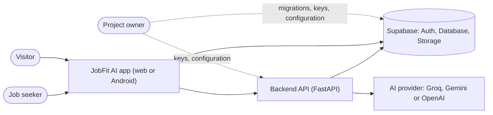
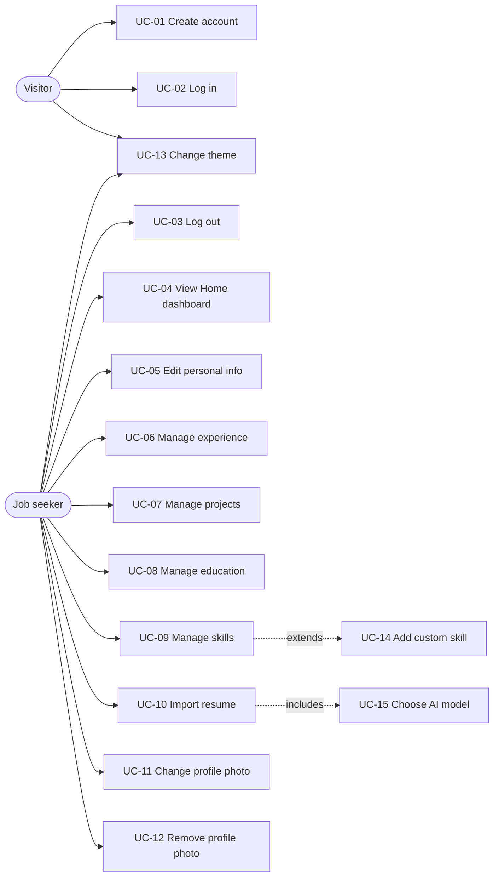
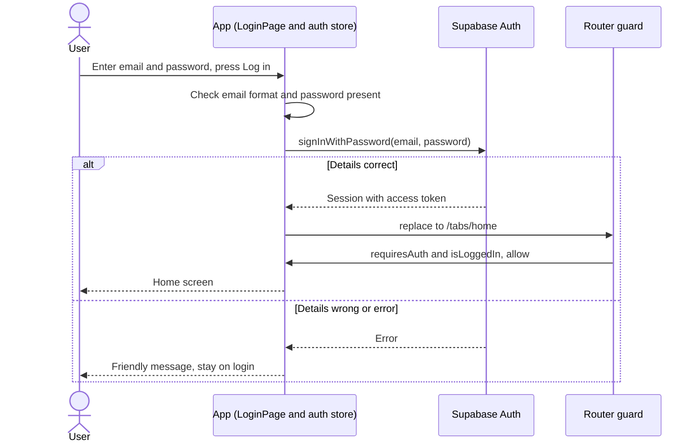
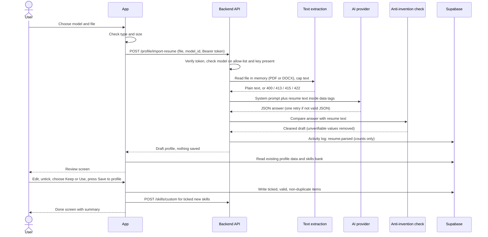
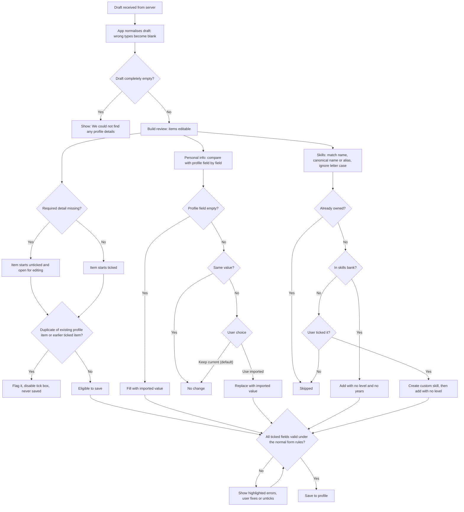
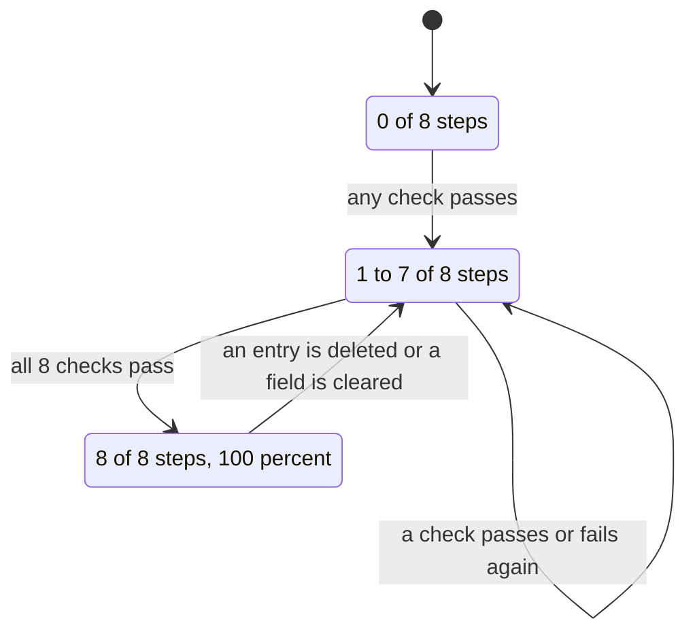

# 04 - System Analysis and Design

| Item | Detail |
|---|---|
| Document | System analysis and design |
| Version | 1.0 draft |
| Date | 24 October 2026 |
| Status | Draft for review |
| Audience | Analysts, developers, testers |

**Purpose:** To describe who uses the system, what they can do (use cases), how the main flows work (diagrams), and which business rules and error cases apply. Only implemented features are modelled. Planned features (Phases 3 to 7) are not shown as working.

---

## 1. Actors and roles

| Actor | Type | Description |
|---|---|---|
| Visitor | Human | A person who is not logged in. Can only see the login screen and change the theme. |
| Job seeker (signed-in user) | Human | Owns a Master Profile. Can use every implemented feature on their own data only. |
| Project owner / administrator | Human | Applies database migrations, sets server configuration and AI keys, runs the system. Has no special screen in the app. |
| Supabase | External system | Provides login (Auth), the Postgres database and file storage. |
| AI provider | External system | Groq, Google Gemini or OpenAI. Reads resume text and returns structured JSON. |
| Backend API | Internal system | FastAPI service that verifies the login token, reads uploaded files, calls the AI provider and writes some records. |

There is a single user role. No administrator screens exist.

## 2. System context

A fuller container view is in [05-architecture.md](05-architecture.md).

## 3. Use-case overview

## 4. Use-case catalogue

Status for all rows below: UC-01 to UC-04 and UC-13 are *Available now* (UC-04's completeness ring and activity list are *Built, awaiting verification*); UC-05 to UC-12, UC-14 and UC-15 are *Built, awaiting verification*.

| ID | Name | Actor | Preconditions | Main flow | Alternative / exception flows | Postconditions |
|---|---|---|---|---|---|---|
| UC-01 | Create account | Visitor | Not logged in; email not yet registered | 1. Choose Sign up. 2. Enter email, password (6 or more characters) and optional name. 3. Press Create account. 4. System creates the account; database trigger creates the profile row. 5. System shows "Account created. Check your email to confirm, then log in." | A1: Invalid email or short password: message under the field, no request sent. A2: Email already registered: "An account with this email already exists...". A3: Network down: "We could not reach the server...". | Account and empty profile exist. Email confirmation may be required (depends on Supabase setting). |
| UC-02 | Log in | Visitor | Account exists (and is confirmed if required) | 1. Enter email and password. 2. Press Log in. 3. Supabase returns a session. 4. App opens Home. | A1: Wrong details: "That email or password does not look right." A2: Email not confirmed: "Please confirm your email first...". A3: Rate limited: "Too many attempts...". | Session stored on the device; user is on Home. |
| UC-03 | Log out | Job seeker | Logged in | 1. Tap the log-out icon on Home. 2. System signs out and clears the profile, photo and import-draft stores. 3. App opens the login screen. | A1: Sign-out fails: not handled specially; **to be confirmed**. | Session removed; in-memory personal data cleared. |
| UC-04 | View Home dashboard | Job seeker | Logged in | 1. Open Home. 2. System loads profile, section counts, last 5 activities, and calls `GET /me`. 3. Shows greeting, completeness, quick actions, recent activity, system status. | A1: Profile or counts fail to load: friendly error in the card. A2: Backend unreachable: status row shows "The backend is not reachable...", Retry available. A3: Pull to refresh reloads everything. | None (read only). |
| UC-05 | Edit personal info | Job seeker | Logged in | 1. Open Profile, Personal info. 2. Edit fields. 3. Press Save. 4. System validates and upserts the profile row. 5. Message "Profile saved." | A1: Validation error: message under the field, nothing saved. A2: Save fails: friendly message above the button. | Profile row updated (including links). |
| UC-06 | Manage experience | Job seeker | Logged in | 1. Open Experience. 2. Add, edit or delete an entry through the sheet or swipe. 3. System validates, writes, shows a message, refreshes list and counts. | A1: Validation error. A2: Delete is cancelled at the confirmation. A3: Save fails: friendly message. | Experience rows changed; completeness updated. |
| UC-07 | Manage projects | Job seeker | Logged in | As UC-06 for projects (technologies entered as comma-separated tags). | As UC-06. | Project rows changed. |
| UC-08 | Manage education | Job seeker | Logged in | As UC-06 for education. | As UC-06. | Education rows changed. |
| UC-09 | Manage skills | Job seeker | Logged in | 1. Open Skills. 2. Add: search the bank, pick a skill, choose level 1 to 5 and optional years, save. Edit: tap a skill. Remove: swipe, confirm. | A1: Skills bank cannot load: "We could not load the skills list." with retry. A2: Skill already owned: hidden from search; database primary key also rejects duplicates ("That item is already in your profile."). | `user_skills` rows changed. |
| UC-14 | Add custom skill | Job seeker | In the Add skill sheet; text not found in the bank | 1. Tap `Add "text" as a new skill`. 2. Choose level. 3. System calls `POST /skills/custom`. 4. Backend returns existing or new skill. 5. App adds it to the user's skills. | A1: Name has invalid characters or wrong length: validation error. A2: Backend fails: "We could not create the new skill..." and the user can pick from the list. | Skill exists once in the shared bank; user owns it. |
| UC-10 | Import resume | Job seeker | Logged in; at least one AI provider configured; PDF/DOCX with text, up to 5 MB | 1. Open Import from resume. 2. UC-15 choose model. 3. Choose file. 4. App checks type and size. 5. App uploads file and model id to `POST /profile/import-resume`. 6. Server extracts text, asks the AI, runs the anti-invention check, returns a draft. 7. App shows the review; loads existing profile data to detect duplicates. 8. User edits, unticks, chooses Keep/Use for conflicts. 9. User presses Save to profile. 10. App writes the ticked, valid, non-duplicate items. 11. Done screen shows a summary. | A1: Wrong type/size: message before upload. A2: Server errors (see section 8): message and Try again or Choose another file. A3: Empty draft: "We could not find any profile details...". A4: Cannot load current profile: saving paused, Try again. A5: Some writes fail: "Saved x of y items..."; retry saves only the rest. A6: Cancel while reading returns to the file chooser. A7: Discard (after edits, with confirmation) wipes the draft. | Chosen items saved. Draft wiped from memory. Activity log has `resume.parsed` with counts. |
| UC-15 | Choose AI model | Job seeker | In the import screen | 1. App calls `GET /ai/models`. 2. Shows models; unavailable ones disabled and labelled "not set up". 3. Preselects saved choice, else server default, else first available. 4. User may change; the choice is saved on the device. | A1: List cannot load: error and Try again. A2: No provider available: message, upload disabled. | Selected model id passed to UC-10. |
| UC-11 | Change profile photo | Job seeker | Logged in; migration 0002 applied | 1. Tap avatar. 2. Choose gallery or camera. 3. App checks type (JPEG/PNG/WebP) and size (10 MB). 4. User moves/zooms in the editor. 5. App renders a 512 by 512 JPEG, uploads it to `avatars/<user_id>/<timestamp>.jpg`, saves the path in the profile, shows it with a signed link, and deletes the previous file. | A1: Wrong type/size: message. A2: Migration missing: "Photo upload is not set up yet...". A3: Upload fails: friendly message; the new file is deleted. | `profiles.avatar_path` set; old file removed. |
| UC-12 | Remove profile photo | Job seeker | A photo exists | 1. Tap avatar, Remove photo, confirm. 2. App clears `avatar_path`, deletes the file. | A1: Cancel at confirmation. A2: Failure: friendly message. | No photo; initials shown. |
| UC-13 | Change theme | Visitor or job seeker | On Login or Home | 1. Tap the palette icon. 2. Choose a theme. 3. App applies it and stores it on the device. | A1: Storage blocked (private mode): theme applies but is not remembered. | `data-theme` set; preference saved. |

## 5. Sequence diagrams

### 5.1 Login

After login, Home calls `GET /api/v1/me` with `Authorization: Bearer <access token>`. The backend verifies the token (see [07](07-security-and-privacy.md)).

### 5.2 Resume import

## 6. Review-and-merge rules (flow)

## 7. State of profile completeness

The completeness value is calculated from real data only. There are 8 equal checks (`computeCompleteness` in `frontend/src/services/dashboard.ts`).

| # | Check | Passes when | Hint shown when it is the next missing step |
|---|---|---|---|
| 1 | Full name | Not empty after trimming | Add your full name |
| 2 | Headline | Not empty | Add a short headline |
| 3 | Summary | Not empty | Write a short summary |
| 4 | Phone or location | Phone or location is not empty | Add your phone or location |
| 5 | Experience | At least 1 experience row | Add your first work experience |
| 6 | Education | At least 1 education row | Add your education |
| 7 | Projects | At least 1 project row | Add a project |
| 8 | Skills | At least 1 user skill row | Add your skills |

Percentage = rounded (checks passed / 8 x 100). The possible values are 0, 13, 25, 38, 50, 63, 75, 88 and 100. The "next step" is the first failing check in the order above. The tick on the Profile screen's *Personal info* row requires checks 1 to 4.

## 8. Business rules

| ID | Rule | Where enforced |
|---|---|---|
| BR-01 | Each account has exactly one profile record; its id equals the account id. | Database (primary key, trigger) |
| BR-02 | A user can read and change only their own rows and files. | Database RLS; every query also filters by user id |
| BR-03 | The AI must not invent skills or experience. Values that cannot be found in the resume text are removed (email, phone, links, month/year dates, years, skills, technologies; "current job" needs a word such as present or current in the text). | `resume_parser.py` |
| BR-04 | Imported skills are saved with no level and no years. | `importSave.ts` |
| BR-05 | Nothing from an import is saved until the user presses Save to profile. | Backend returns a draft only; app writes after confirmation |
| BR-06 | Experience duplicate key: company + role + start month (letter case and extra spaces ignored). | `importLogic.ts` |
| BR-07 | Education duplicate key: school + degree. | `importLogic.ts` |
| BR-08 | Project duplicate key: project name. | `importLogic.ts` |
| BR-09 | A skill the user already owns is skipped. | `importLogic.ts` |
| BR-10 | An import item missing a required detail (experience: role or company; education: school; project: name) starts unticked. | `importLogic.ts` |
| BR-11 | Personal info merge: fill empty fields; if both differ, keep current unless the user chooses Use imported; email is never imported. | `importLogic.ts` |
| BR-12 | Imported values that will be saved must pass the same rules as the normal forms. | `importLogic.ts` |
| BR-13 | A current job has no end date. | `resume_parser.py`, `importLogic.ts` |
| BR-14 | Experience sort: current jobs first, then by end month, then start month. Projects and others: sort order, then newest created. Education: latest end year first. | `profileLogic.ts` |
| BR-15 | A skill added by hand needs a level from 1 to 5. The database allows an empty level (for imported skills). | App forms; migration 0001 |
| BR-16 | A custom skill name is 2 to 60 characters with letters, digits, spaces and `. + # - / & _` only. The category is up to 30 characters. | `skills.py` (API) |
| BR-17 | A custom skill is stored once: the lowercase, single-spaced name is checked against existing names and aliases first. | `services/skills.py` |
| BR-18 | Custom skills are stored in the shared skills bank and are visible by name to all signed-in users. | Migration 0001 (read policy for all signed-in users) |
| BR-19 | Resume file: PDF or DOCX, 1 byte to 5 MB, real content must match the extension. | `resume_text.py` |
| BR-20 | At most 30 PDF pages are read; text is cut at 30,000 characters; fewer than 50 characters of text counts as "no readable text". | `resume_text.py` |
| BR-21 | Only models on the server's allow-list can be used. With no model chosen, the default is the first available model in the order Groq, Gemini, OpenAI. | `ai_providers.py` |
| BR-22 | If an AI answer is not valid JSON, the request is retried once. HTTP errors are not retried. | `ai_providers.py` |
| BR-23 | The draft is limited to 20 experiences, 10 education entries, 20 projects, 60 skills, 12 bullets per experience and 30 technologies per project. | `resume_parser.py` |
| BR-24 | Photo: JPEG, PNG or WebP up to 10 MB in; 512 by 512 JPEG out (target at most 1.8 MB; the bucket limit is 2 MB). Each upload gets a new file name; the previous file is deleted. | `imageCrop.ts`, migration 0002 |
| BR-25 | Profile completeness is 8 equal checks (section 7). | `dashboard.ts` |
| BR-26 | Where AI free-text limits and form limits differ, the stricter form rule applies when the user saves (for example bullets over 300 characters must be shortened). | `importLogic.ts`, `resume_parser.py` |
| BR-27 | Activity log rows can only be written by the backend. | Migration 0001 (no write policy) |

## 9. Error handling matrix

Backend errors for resume import, and what the user sees. "Detail" is the message the server sends.

| ID | Situation | Detected by | HTTP | Detail (server) | What the app shows |
|---|---|---|---|---|---|
| ERR-01 | Missing or invalid login token | API auth | 401 | "Missing bearer token" or "Invalid token: ..." | "Your session has ended. Please log in again." |
| ERR-02 | Unknown model id | Allow-list | 400 | "Unknown AI model" | "Unknown AI model" (the app shows the server's short sentence; normally the model list prevents this) |
| ERR-03 | No AI configured | Model resolver | 503 | "AI is not set up on the server" | That text (it is a friendly sentence) |
| ERR-04 | Chosen provider has no key | Model resolver | 503 | "<Provider> is not set up on the server" | That text |
| ERR-05 | No file | Upload reader | 400 | "No file was uploaded" | That text |
| ERR-06 | Empty file | Upload reader | 400 | "The uploaded file is empty" | That text |
| ERR-07 | File over 5 MB | Upload reader | 413 | "The file is too large (maximum 5 MB)" | That text |
| ERR-08 | Wrong type or content | Type check | 415 | "Please upload a PDF or DOCX file." | That text |
| ERR-09 | Password-protected PDF | PDF reader | 422 | "This PDF is password protected. Please remove the password and try again." | That text |
| ERR-10 | Damaged file | Text extraction | 422 | "We could not read this file. It may be damaged." | That text |
| ERR-11 | No readable text (scan) or under 50 characters | Text extraction | 422 | "We could not find readable text in this file. If it is a scanned image, please upload a text-based PDF or DOCX." | That text |
| ERR-12 | Provider busy / rate limited | Provider layer | 429 | "The AI service is busy right now. Please wait a minute and try again." | That text, with Try again |
| ERR-13 | Provider quota or billing exhausted | Provider layer | 429 | "<Provider> has no credit or quota left on this key. Please pick another model." | That text, with Try again |
| ERR-14 | Provider rejected the key | Provider layer | 502 | "<Provider> key was rejected. Please check the key on the server." | That text, with Try again |
| ERR-15 | Provider cannot find the model | Provider layer | 502 | "<Provider> could not find this model. Please pick another model." | That text, with Try again |
| ERR-16 | Timeout, other provider error, or unusable answer twice | Provider layer | 502 | "The AI service could not read this resume. Please try again." | That text, with Try again |
| ERR-17 | Network down at the app | Browser | none | - | "We could not reach the server. Please check your internet connection and try again." |
| ERR-18 | Draft completely empty | App | none | - | "We could not find any profile details in that file. Please try another resume." |
| ERR-19 | Custom skill cannot be saved | `POST /skills/custom` | 500 | "Could not save the skill" | "We could not create the new skill..." |
| ERR-20 | Custom skill input invalid | Pydantic validation | 422 | Validation list from FastAPI | Not shown raw; the app already validates length first |
| ERR-21 | Database write fails in the app | Supabase | varies | - | "Something went wrong while saving. Please try again." (or specific messages for duplicates and permission) |
| ERR-22 | Photo storage not prepared | Supabase | varies | - | "Photo upload is not set up yet - run the database update." |

Provider details (response bodies and keys) are never sent to the app. Short reasons for 404 and 429 are written to the server log only.

Related: [08-api-reference.md](08-api-reference.md), [06-data-model.md](06-data-model.md).
