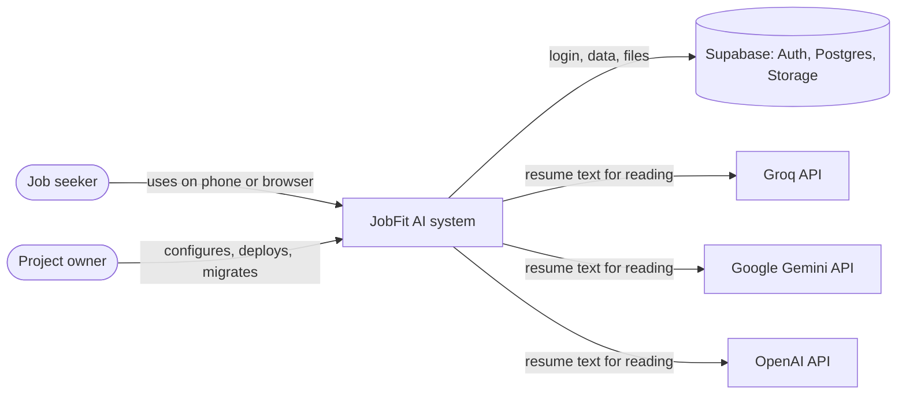
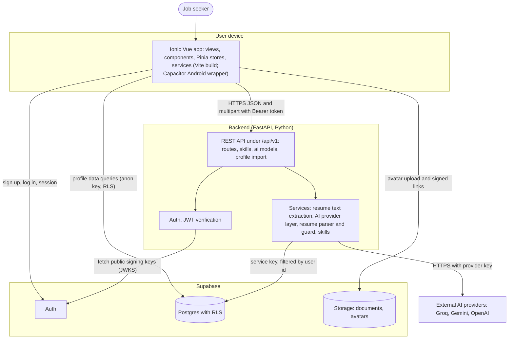
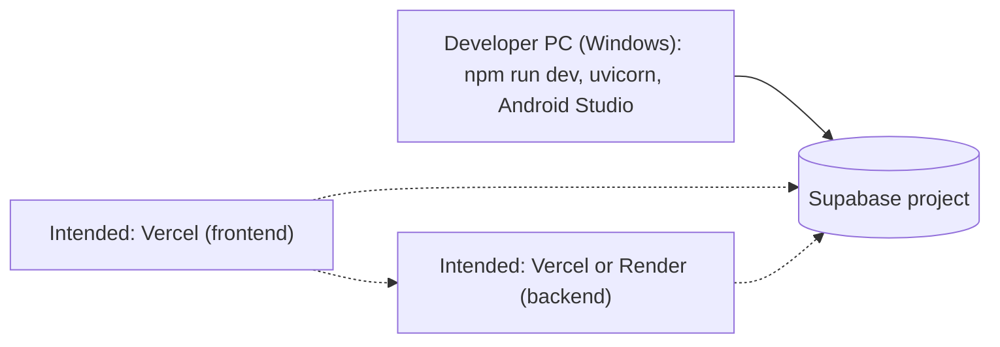

# 05 - Architecture

| Item | Detail |
|---|---|
| Document | Architecture description |
| Version | 1.0 draft |
| Date | 24 October 2026 |
| Status | Draft for review |
| Audience | Developers and technical stakeholders |

**Purpose:** To explain how JobFit AI is built, why it is built that way, and where each responsibility lives. Everything here was read from the repository on 24 October 2026. Anything not proven by the repository is marked *intended* or *to be confirmed*.

---

## 1. Overview and rationale

JobFit AI has three parts:

1. **A mobile-first app** (Ionic + Vue 3, packaged for Android with Capacitor, also runs in a browser).
2. **A small backend API** (Python FastAPI).
3. **Supabase** for login, the Postgres database and file storage.

The guiding idea is a clear split of responsibilities:

| Kind of work | Where it runs | Why |
|---|---|---|
| Simple reads and writes of the user's own data (profile, experience, projects, education, skills, photo) | The app talks **directly to Supabase**, protected by Row Level Security | Fewer moving parts, faster screens, the database itself guarantees privacy |
| Anything needing a secret key, file parsing, or an AI call (resume import, adding a shared custom skill, listing AI models) | The **backend API** | Secrets must never reach the app; the shared skills bank must not be writable by users |

This follows the project's frontend rule: simple user data may use the Supabase client directly; AI work, file handling and anything needing the secret key goes through FastAPI.

## 2. System context (C4 level 1)

## 3. Containers (C4 level 2)

## 4. Technology stack

Versions are the ranges declared in `frontend/package.json` and `backend/requirements.txt`; they are not guaranteed installed versions.

| Layer | Technology | Purpose |
|---|---|---|
| Frontend framework | Vue 3 (`^3.5`), Composition API, `<script setup lang="ts">` | Screens and logic |
| UI toolkit | Ionic Vue (`@ionic/vue ^9.0.0`) | Mobile-style components, navigation, gestures |
| Native wrapper | Capacitor 8 (core, Android, App, Haptics, Keyboard, Status Bar) | Run the web app as an Android app |
| Build tool | Vite 8 with Vue plugin and legacy plugin | Dev server and production build |
| Styling | Tailwind CSS 4 and daisyUI 5 (35 themes) bridged to Ionic colours; custom CSS | Look and feel |
| State | Pinia | Shared state: auth, profile, avatar, resume import, theme |
| Routing | `@ionic/vue-router` with vue-router | Tabs and sub-screens, login guard |
| Frontend tests | Vitest + jsdom, Vue Test Utils; Cypress configured but only a starter spec exists | Unit tests |
| Backend framework | Python (3.12 per project notes; the Phase 1 README says 3.11 or newer) with FastAPI (`>=0.115`), Uvicorn | REST API |
| Validation and settings | Pydantic v2, pydantic-settings | Request/response models, environment settings |
| Auth verification | PyJWT with crypto | Verify Supabase tokens |
| Supabase access | `supabase` Python client | Server-side database access |
| HTTP to AI providers | `httpx` (no provider SDKs) | Provider calls |
| File reading | `pypdf`, `python-docx`, `python-multipart` | PDF text, DOCX text, uploads |
| Backend tests | pytest | API and logic tests |
| Database | Supabase Postgres, extensions `vector` (pgvector) and `pg_trgm` | Data, future semantic matching |
| Auth and storage | Supabase Auth and Storage | Login, files |
| AI (current) | Groq, Google Gemini, OpenAI (free tiers) for resume import | Read resumes |
| AI (planned) | Claude API from Phase 3 (variable `ANTHROPIC_API_KEY` is reserved, unused) | Job parsing, generation |

Note on versions: the project notes say "Ionic 8" while `package.json` declares `@ionic/vue ^9.0.0`. The declared range is what installs. See [09-roadmap-and-status.md](09-roadmap-and-status.md), section 6.

## 5. Components

### 5.1 Frontend (`frontend/src`)

| Module | Contents | Responsibility |
|---|---|---|
| `router/` | Route table, `beforeEach` guard | `/login` (guests only); `/tabs/...` requires login; routes for Home, Profile, five profile sub-screens, Import, Jobs, Tracker |
| `views/` | `LoginPage`, `TabsPage`, `HomePage`, `ProfilePage`, `PersonalInfoPage`, `ExperiencePage`, `ProjectsPage`, `EducationPage`, `SkillsPage`, `ImportResumePage`, `JobsPage`, `TrackerPage` | Screens. Jobs and Tracker show "Coming soon" only |
| `components/` | Form sheets, import review cards, avatar changer/editor/cropper, theme picker, progress ring, empty states and others | Reusable UI parts |
| `stores/` | `auth`, `profile`, `avatar`, `resumeImport`, `theme` | Shared state and orchestration |
| `services/` | `supabase`, `api`, `profile`, `skills`, `dashboard`, `avatar`, `resumeImport`, `importSave`, `aiModels`, `errors`, `feedback`, `haptics`, `motion`, `imageCrop` | Network calls and pure logic (kept separate so logic can be unit tested) |
| `services/*Logic.ts` | `profileLogic`, `importLogic`, `avatarLogic` | Pure functions: validation, sorting, duplicate detection, merge, crop maths |
| `composables/` | `useSectionCrud`, `useIdentity`, `useCountUp` | Shared list/add/edit/delete flow; user name and photo; animated numbers |
| `theme/` | `daisy.css`, `variables.css`, `ui.css`, `motion.css`, `ionicBridge.ts` | Themes and the bridge to Ionic colours |

Key behaviours:

- `services/api.ts` attaches `Authorization: Bearer <Supabase access token>` to backend calls and builds URLs from `VITE_API_URL`.
- `apiUpload` sends multipart forms (no manual content type) and throws `ApiError(status, detail)`.
- The Pinia stores `resumeImport`, `profile` and `avatar` are reset at log out so the next person sees nothing.
- The resume import draft is kept only in memory (never in local storage).

### 5.2 Backend (`backend/app`)

| Module | Responsibility |
|---|---|
| `main.py` | Creates the FastAPI app (version 0.1.0), adds CORS, mounts four routers under `/api/v1`, root route `/` |
| `api/routes.py` | `GET /health`, `GET /me` |
| `api/skills.py` | `POST /skills/custom` with Pydantic models |
| `api/ai_models.py` | `GET /ai/models` |
| `api/profile_import.py` | `POST /profile/import-resume` and the draft response models |
| `core/config.py` | Settings from environment (`.env` locally); lists of origins and models |
| `core/auth.py` | `get_current_user`: reads the Bearer token, verifies it (HS256 with secret, or ES256/RS256 through the JWKS URL), requires audience `authenticated`, `exp` and `sub` |
| `db/supabase_client.py` | Cached admin client (service key; bypasses RLS) and `log_activity` (failures never break a request) |
| `services/resume_text.py` | Read upload, check type, extract text in memory |
| `services/ai_providers.py` | Provider list, allow-list, request building, error mapping, JSON retry |
| `services/resume_parser.py` | Prompt, tolerant reshaping of AI output, and the anti-invention guard |
| `services/skills.py` | Find or create a custom skill (race-safe) |

### 5.3 Database and storage

Summarised here; details in [06-data-model.md](06-data-model.md).

- 11 tables created in migration 0001 and one column added in 0002. Only `profiles`, `experiences`, `projects`, `education`, `skills`, `user_skills` and `activity_logs` are used by the current app. The job, match, document and application tables are prepared for later phases.
- Storage buckets: `documents` (private, prepared for Phase 4) and `avatars` (private, 2 MB, JPEG/PNG/WebP).

## 6. Data flows

| Flow | Path |
|---|---|
| Sign up / log in | App -> Supabase Auth. A database trigger creates the profile row. |
| Edit profile sections | App -> Supabase Postgres (anon key + user token; RLS; also filtered by user id in code). |
| Home health check | App -> `GET /me` -> admin client reads the profile row -> activity log write. |
| Add custom skill | App -> `POST /skills/custom` -> admin client inserts into `skills` -> App then inserts into `user_skills` directly. |
| List AI models | App -> `GET /ai/models` (no provider call). |
| Resume import | App -> `POST /profile/import-resume` -> extract text -> AI provider -> guard -> draft to App. App reads existing data from Supabase, then writes the chosen items to Supabase (and calls `POST /skills/custom` for new skills). |
| Profile photo | App crops and shrinks in the browser -> uploads to Storage `avatars/<user_id>/<timestamp>.jpg` -> saves the path in `profiles.avatar_path` -> asks Storage for a signed link valid for 1 hour and renews it before it expires. |

## 7. Deployment view

The repository contains **no** deployment configuration (no `vercel.json`, no Render file, no container file). The following is the **intended** deployment from the project notes.

| Part | Intended host | Status |
|---|---|---|
| Frontend (web) | Vercel | Intended; not configured in the repo |
| Backend API | Vercel or Render | Intended; choice open |
| Database, Auth, Storage | Supabase (hosted project) | In use for development |
| Android app | Built locally with Capacitor and Android Studio | Debug build only; release signing not set up |

## 8. Environments and configuration

Only variable **names** are shown. Never put real values in documents or in source control. `.env` files are ignored by Git; `.env.example` files hold placeholders.

### 8.1 Backend (`backend/.env`, template `backend/.env.example`)

| Variable | Purpose | Secret? |
|---|---|---|
| `APP_ENV` | Environment name reported by `/health` (default `development`) | No |
| `SUPABASE_URL` | Supabase project address | No |
| `SUPABASE_SERVICE_KEY` | Server-only secret key; bypasses RLS | **Yes** |
| `SUPABASE_JWT_SECRET` | Only for old projects that sign tokens with a shared secret (HS256) | **Yes** |
| `CORS_ORIGINS` | Comma-separated list of allowed app origins | No |
| `ANTHROPIC_API_KEY` | Reserved for Phase 3; unused today | **Yes** |
| `GROQ_API_KEY`, `GEMINI_API_KEY`, `OPENAI_API_KEY` | One key per AI provider; empty means "not set up" | **Yes** |
| `GROQ_MODELS`, `GEMINI_MODELS`, `OPENAI_MODELS` | Comma-separated allow-lists of model ids per provider | No |

`APP_NAME` can also be set (it has a default in code) but is not in `.env.example`.

### 8.2 Frontend (`frontend/.env`, template `frontend-files/.env.example`)

| Variable | Purpose | Secret? |
|---|---|---|
| `VITE_SUPABASE_URL` | Supabase project address | No |
| `VITE_SUPABASE_ANON_KEY` | Publishable (anon) key only; never the service key | No (public by design) |
| `VITE_API_URL` | Backend base address, must end with `/api/v1` | No |

These values are baked into the app at build time, so the app must be rebuilt after changing them. See [12-installation-and-operations.md](12-installation-and-operations.md).

## 9. AI provider layer design

Implemented in `backend/app/services/ai_providers.py`.

| Aspect | Design |
|---|---|
| Providers | Groq, Google Gemini, OpenAI. Order for defaults: Groq, then Gemini, then OpenAI |
| Transport | Plain `httpx` requests; **no provider SDKs**. Groq and OpenAI share the chat-completions format; Gemini uses its own `generateContent` format with the key in a header |
| Model addressing | `"<provider>:<model>"`, for example `groq:openai/gpt-oss-120b` |
| Configurable lists | Models come from environment variables, because model names change. Unknown model names are shown with their raw name |
| Allow-list | `resolve_model` accepts only ids from the configured lists. An unknown id gives 400; a provider without a key gives 503. The client's string is never forwarded blindly |
| Availability | A model is available when its provider key is set. `GET /ai/models` reports this without calling any provider |
| Default | First available model in provider order; `null` if none |
| Output | JSON mode requested (`response_format` json_object for Groq/OpenAI; `responseMimeType` application/json for Gemini), temperature 0 |
| Parsing | Lenient: ignores code fences and text around the outermost `{...}` |
| Retry | If the answer is not usable JSON, exactly one more attempt. HTTP errors are **not** retried |
| Timeout | 60 seconds per request |
| Error mapping | 401/403 from provider -> 502 "key was rejected"; 429 -> 429 busy, or "no credit or quota" when the provider says quota/billing; 404 -> 502 "could not find this model"; other errors/timeouts -> 502 generic. Provider bodies and keys are never returned |
| Logging | Server log gets provider name, status code and (for 404 and 429 only) a short provider reason cut to 160 characters. Prompts, resume text and answers are never logged |

After the AI layer, `resume_parser.py` reshapes sloppy output (null instead of lists, numbers as text, wrapper objects) and then applies the **anti-invention guard** described in [07-security-and-privacy.md](07-security-and-privacy.md).

Default model names in `.env.example` and `config.py` at the time of writing are `openai/gpt-oss-120b` and `openai/gpt-oss-20b` (Groq), `gemini-3.8-flash` and `gemini-3.5-flash-lite` (Gemini), and `gpt-4o-mini` (OpenAI). Provider model names change over time; whether each is currently valid is **to be confirmed** by a real call (not done in automated tests).

## 10. Design decisions and trade-offs

| # | Decision | Alternatives | Reason | Trade-off |
|---|---|---|---|---|
| D-1 | Simple profile data goes straight from the app to Supabase with RLS | Route everything through the API | Fewer endpoints, faster, privacy enforced by the database | Direct writes are not written to the activity log; business rules live in the app |
| D-2 | AI, file reading and shared-skill writes go through the API | Do them in the app | Keys stay on the server; users cannot write to the shared bank | Needs a running backend |
| D-3 | Resume import uses free-tier Groq/Gemini/OpenAI, chosen by the user | Anthropic Claude for import | Lower cost during development | Rate limits; free plans may use submitted content; model names change |
| D-4 | No provider SDKs, plain `httpx` | Official SDKs | Fewer dependencies; uniform error handling | Provider API changes must be tracked by hand |
| D-5 | Model lists in environment, plus allow-list | Hard-coded names | Names change often; prevents arbitrary model use | Needs a restart after edits |
| D-6 | Import returns a draft; the app saves after review | Save directly | User stays in control; supports the "never invent" rule | More screens |
| D-7 | Server-side anti-invention guard on top of the prompt | Trust the prompt | Small free models are not exact | Free-text fields are not word-for-word verified |
| D-8 | Imported skills have no level | Estimate a level | Never guess | Extra step for the user |
| D-9 | Private `avatars` bucket and signed links | Public bucket | Photos are personal data | Links expire and must be renewed |
| D-10 | New avatar file name per upload | Overwrite one file | Avoids stale cached images | Old file must be deleted |
| D-11 | Skills bank is global and read-only for users | Per-user skills | Shared names, future embedding matching | Custom skill names are visible to all users |
| D-12 | Pure logic in separate `*Logic.ts` files | Logic in components | Easy unit testing | More files |
| D-13 | daisyUI themes bridged into Ionic | Ionic-only theme | Many themes with little code | Extra build tooling (Tailwind) |

## 11. Mobile (Capacitor / Android) notes

| Topic | Fact from the repository |
|---|---|
| Wrapper | Capacitor 8 with the Android platform added; no iOS project yet |
| Build steps | From `frontend`: `npm run build`, then `npx cap sync android`, then run from Android Studio |
| App identity | `capacitor.config.ts` still uses the starter values `appId: 'io.ionic.starter'` and `appName: 'frontend'`. These must be changed before any release |
| Permissions | The manifest declares only `INTERNET`. No camera permission is declared; whether "Take a photo" works on a device is **unverified** |
| Cleartext traffic | `usesCleartextTraffic="true"` is set, so plain `http://` works for local development. Remove for release with an HTTPS backend |
| Emulator networking | Inside the Android emulator, `localhost` is the emulator itself; use `http://10.0.2.2:8000/api/v1` for the backend |
| Real phone | Use the PC's local network address and start the backend with `--host 0.0.0.0` |
| CORS | `backend/.env.example` allows `capacitor://localhost` and `http://localhost` in addition to the Vite ports |
| Native plugins | Haptics (tap feedback), Keyboard, Status Bar, App |
| Photo capture | A hidden file input with `capture="user"` asks the phone for the camera; in a desktop browser it opens a file picker |

Related: [08-api-reference.md](08-api-reference.md), [12-installation-and-operations.md](12-installation-and-operations.md).
