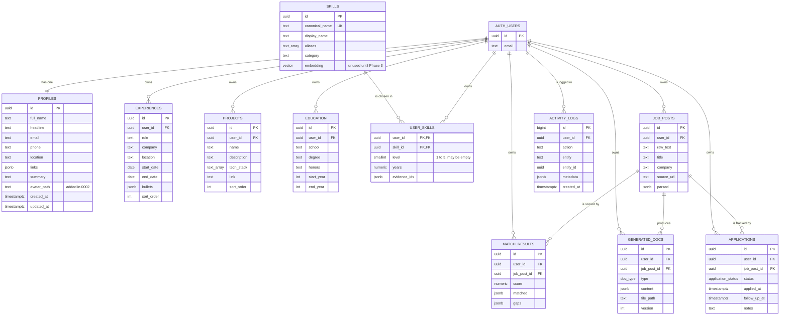

# 06 - Data Model

| Item | Detail |
|---|---|
| Document | Data model |
| Version | 1.0 draft |
| Date | 24 October 2026 |
| Status | Draft for review |
| Audience | Developers, database staff, analysts |

**Purpose:** To describe the database tables, how they relate, who may read and write them (Row Level Security), the storage buckets, and the shape of the resume import draft. Source: `supabase/migrations/0001_init.sql` and `0002_profile_avatars.sql`.

---

## 1. Overview

- The database is Supabase Postgres. User accounts live in Supabase's own `auth.users` table.
- Migration **0001** creates the full Phase 1 schema (including tables for later phases), the security rules, one storage bucket and 25 seed skills.
- Migration **0002** adds `profiles.avatar_path` and the private `avatars` bucket with its rules.
- Migrations are numbered, written to be safe to run again, and must never be edited after they have been run.
- Migration order matters: run 0001 first, then 0002.
- Extensions enabled: `vector` (pgvector, for future skill matching) and `pg_trgm` (fuzzy text search on skill names).

## 2. Entity list

| Entity (table) | Purpose | Used by the app today? | Phase |
|---|---|---|---|
| `profiles` | One row per user: personal details and photo path | Yes | 1 (photo column in 2) |
| `experiences` | Work history | Yes | 1 |
| `projects` | Projects | Yes | 1 |
| `education` | Education | Yes | 1 |
| `skills` | Shared global skills bank | Yes (read; backend writes custom skills) | 1 |
| `user_skills` | Which skills a user has, with level and years | Yes | 1 |
| `activity_logs` | Log of actions written by the backend | Yes (Home reads the last 5) | 1 |
| `job_posts` | Pasted job descriptions and parsed data | No | Planned (3) |
| `match_results` | Score, matched skills and gaps per job | No | Planned (3) |
| `generated_docs` | Generated resumes and cover letters | No | Planned (3, 4) |
| `applications` | Application tracker | No | Planned (5) |

Enumerated types: `application_status` (saved, applied, interview, offer, rejected, ghosted) and `doc_type` (resume, cover_letter). Both are for later phases.

## 3. Entity-relationship diagram



In the diagram `text_array` means a Postgres `text[]` column. Only the main columns of the future-phase tables are drawn; see section 4 for all columns.

## 4. Data dictionary

Common pattern: `id` is a generated UUID; `created_at`/`updated_at` are `timestamptz` defaulting to the current time; `updated_at` is refreshed by a trigger on `profiles`, `experiences`, `projects`, `education` and `applications`. All user-owned tables delete their rows automatically when the user is deleted (`on delete cascade`).

### 4.1 `profiles`

| Column | Type | Nullable | Description |
|---|---|---|---|
| `id` | uuid (PK, references `auth.users`) | No | Same as the account id |
| `full_name` | text | Yes | Name; set from the sign-up name by the trigger (empty text if none) |
| `headline` | text | Yes | Short title line |
| `email` | text | Yes | Copied from the account at sign-up |
| `phone` | text | Yes | Phone |
| `location` | text | Yes | City and country |
| `links` | jsonb, default `{}` | No | Web links, keys `github`, `linkedin`, `website` (other keys are kept if present) |
| `summary` | text | Yes | Short personal summary |
| `avatar_path` | text | Yes | Object path in bucket `avatars`, `<user_id>/<timestamp>.jpg`; null means no photo (added by 0002) |
| `created_at`, `updated_at` | timestamptz | No | Timestamps |

A database trigger (`handle_new_user`) inserts the profile row when an account is created.

### 4.2 `experiences`

| Column | Type | Nullable | Description |
|---|---|---|---|
| `id` | uuid PK | No | Identifier |
| `user_id` | uuid FK | No | Owner |
| `role` | text | No | Job title |
| `company` | text | No | Employer |
| `location` | text | Yes | Place |
| `start_date` | date | Yes | First day of the start month (app stores `YYYY-MM-01`) |
| `end_date` | date | Yes | Null means present |
| `bullets` | jsonb, default `[]` | No | List of bullet-point texts |
| `sort_order` | int, default 0 | No | Computed by the app so the newest is first (smaller = higher) |
| `created_at`, `updated_at` | timestamptz | No | Timestamps |

### 4.3 `projects`

| Column | Type | Nullable | Description |
|---|---|---|---|
| `id` | uuid PK | No | Identifier |
| `user_id` | uuid FK | No | Owner |
| `name` | text | No | Project name |
| `description` | text | Yes | Description |
| `tech_stack` | text[], default empty | No | Technology tags |
| `link` | text | Yes | Web address |
| `sort_order` | int, default 0 | No | Order; ties show the newest first |
| `created_at`, `updated_at` | timestamptz | No | Timestamps |

### 4.4 `education`

| Column | Type | Nullable | Description |
|---|---|---|---|
| `id` | uuid PK | No | Identifier |
| `user_id` | uuid FK | No | Owner |
| `school` | text | No | School |
| `degree` | text | Yes | Degree |
| `honors` | text | Yes | Honors |
| `start_year`, `end_year` | int | Yes | Four-digit years |
| `created_at`, `updated_at` | timestamptz | No | Timestamps |

### 4.5 `skills` (shared bank)

| Column | Type | Nullable | Description |
|---|---|---|---|
| `id` | uuid PK | No | Identifier |
| `canonical_name` | text, unique | No | Lowercase matching name, for example `vue.js` |
| `display_name` | text | No | Name shown to users, for example `Vue.js` |
| `aliases` | text[], default empty | No | Other names, for example `vue`, `vuejs` |
| `category` | text | Yes | Group such as frontend, backend, data, soft-skill |
| `embedding` | vector(1536) | Yes | Reserved for Phase 3; unused |
| `created_at` | timestamptz | No | Timestamp |

Indexes: GIN on `aliases` and a trigram GIN index on `canonical_name`. Seed: 25 skills (Python, FastAPI, Laravel, PHP, JavaScript, TypeScript, Vue.js, Ionic, Capacitor, SQL, PostgreSQL, MongoDB, Supabase, pandas, Power BI, Excel, Data Analysis, Docker, Git, REST API, LLM / Generative AI, Automation, Canva, Communication, Leadership).

### 4.6 `user_skills`

| Column | Type | Nullable | Description |
|---|---|---|---|
| `user_id` | uuid FK | No | Owner (part of the primary key) |
| `skill_id` | uuid FK to `skills` | No | The skill (part of the primary key, so no duplicates per user) |
| `level` | smallint, check 1 to 5 | Yes | Empty for skills imported from a resume until the user sets it |
| `years` | numeric(4,1) | Yes | Years of experience (the app allows 0 to 60) |
| `evidence_ids` | jsonb, default `[]` | No | Reserved for linking evidence in later phases |
| `created_at` | timestamptz | No | Timestamp |

### 4.7 `activity_logs`

| Column | Type | Nullable | Description |
|---|---|---|---|
| `id` | bigint identity PK | No | Identifier |
| `user_id` | uuid FK | No | Owner |
| `action` | text | No | Code such as `auth.me_checked`, `skill.created`, `resume.parsed` |
| `entity`, `entity_id` | text, uuid | Yes | What the action was about |
| `metadata` | jsonb, default `{}` | No | Small facts. For `resume.parsed`: provider, model, counts per section, file type. Never the resume text |
| `created_at` | timestamptz | No | Timestamp (index on user and time) |

Only the backend writes this table. Edits made directly by the app (profile, experience, and so on) are **not** logged today.

### 4.8 Tables for later phases (not used yet)

| Table | Main columns |
|---|---|
| `job_posts` | `raw_text` (required), `title`, `company`, `source_url`, `parsed` (jsonb) |
| `match_results` | `job_post_id`, `score` (0 to 100), `matched` (jsonb), `gaps` (jsonb) |
| `generated_docs` | `job_post_id`, `type` (resume or cover_letter), `content` (jsonb), `file_path`, `version`, `model`, `tokens_used`, `duration_ms` |
| `applications` | `job_post_id`, `status` (default `saved`), `applied_at`, `follow_up_at`, `notes`; index on status and follow-up date |

## 5. Relationships

| From | To | Rule |
|---|---|---|
| `profiles.id` | `auth.users.id` | One to one; deleted with the account |
| `experiences`, `projects`, `education`, `user_skills`, `job_posts`, `match_results`, `generated_docs`, `applications`, `activity_logs` `.user_id` | `auth.users.id` | Many to one; deleted with the account |
| `user_skills.skill_id` | `skills.id` | Many to one; deleting a skill removes the links |
| `match_results`, `generated_docs`, `applications` `.job_post_id` | `job_posts.id` | Many to one; deleted with the job post |

## 6. Row Level Security (RLS) summary

RLS means the database itself checks, on every query, whether the signed-in user may touch a row. It is switched on for all 11 tables. The check uses the signed-in user's id (`auth.uid()`).

| Table | Policy | Who | What |
|---|---|---|---|
| `profiles` | "own profile" | signed-in users | All actions, only where `id` equals their id |
| `experiences`, `projects`, `education`, `user_skills`, `job_posts`, `match_results`, `generated_docs`, `applications` | "own rows" | signed-in users | All actions, only where `user_id` equals their id |
| `activity_logs` | "read own logs" | signed-in users | Read only, own rows. No write policy, so only the backend (service key) can write |
| `skills` | "read skills" | signed-in users | Read all rows. No write policy, so only the backend can add skills |

The backend's service key **bypasses RLS**, so every backend query on user data must filter by the user's id (this is a project rule).

## 7. Storage buckets and path conventions

| Bucket | Visibility | Limits | Path convention | Policies (signed-in users, own folder only) | Phase |
|---|---|---|---|---|---|
| `documents` | Private | none set | `<user_id>/<job_post_id>/<file>.pdf` | Read, delete. No insert policy, so uploads will be made by the backend | Created in 1, used from Phase 4 |
| `avatars` | Private (forced false by 0002) | 2 MB; JPEG, PNG, WebP | `<user_id>/<timestamp>.jpg` | Read, insert, update, delete | 2 |

"Own folder" means the first folder in the path equals the signed-in user's id. The app never uses a public address: it asks Storage for a signed link valid for 3,600 seconds (1 hour) and renews it about 5 minutes before it expires.

The uploaded **resume file** is not stored anywhere (see section 9).

## 8. Sample import draft (dummy data)

This is the shape returned by `POST /api/v1/profile/import-resume`. All values below are fictional. Every key is always present; missing information is `null` or an empty list.

```json
{
  "personal": {
    "full_name": "Alex Sample",
    "headline": "Junior Web Developer",
    "email": "alex.sample@example.com",
    "phone": "+1 555 010 0000",
    "location": "Sampletown",
    "github": "github.com/alexsample",
    "linkedin": null,
    "website": null,
    "summary": "Web developer who builds small business websites."
  },
  "experiences": [
    {
      "role": "Web Developer",
      "company": "Example Studio",
      "location": "Sampletown",
      "start_date": "2023-06",
      "end_date": null,
      "is_current": true,
      "bullets": ["Built landing pages for local shops."]
    }
  ],
  "education": [
    {
      "school": "Sample University",
      "degree": "BSc Information Technology",
      "honors": null,
      "start_year": 2019,
      "end_year": 2023
    }
  ],
  "projects": [
    {
      "name": "Recipe Finder",
      "description": "A small web app to search recipes.",
      "tech_stack": ["Vue.js", "JavaScript"],
      "link": null
    }
  ],
  "skills": ["JavaScript", "Vue.js", "Git"]
}
```

Notes: dates are `YYYY-MM` strings; years are integers; the app ignores `email` when merging personal info.

## 9. Data retention and ownership notes

| Topic | Fact |
|---|---|
| Ownership | Every user-owned row belongs to one account and is invisible to others. The shared `skills` table is the one exception: custom skill *names* are visible to all signed-in users |
| Deleting an account | All the user's rows are removed automatically (cascade). Storage files are not covered by this cascade; deleting the photo file for a deleted account is **to be confirmed**. The app has no delete-account screen |
| Resume file and text | Not stored and not logged. Only the saved, reviewed items remain |
| Activity logs | Kept until the account is deleted; there is no purge job |
| Photos | Old photo files are deleted when a new photo is saved or the photo is removed. A failed cleanup can leave an unused file (harmless, private) |
| Device storage | The browser keeps the login session, the chosen theme (`jobfit-theme`) and the last AI model choice (`jobfit-ai-model`). Resume drafts are never written there |
| Backups and retention periods | Not defined in the repository: **to be defined** |

Related: [07-security-and-privacy.md](07-security-and-privacy.md), [08-api-reference.md](08-api-reference.md).
