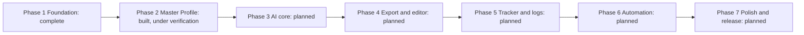

# 09 - Roadmap and Status

| Item | Detail |
|---|---|
| Document | Roadmap and status report |
| Version | 1.0 draft |
| Date | 24 October 2026 |
| Status | Draft for review |
| Audience | Clients, project owner, planners |

**Purpose:** To show honestly where the project stands on 24 October 2026, what Phase 2 delivered, what is known to be limited, what is open, and what should happen next. No target dates have been agreed, so none are given.

---

## 1. Phase roadmap

| Phase | Name | Scope | Status on 24 October 2026 |
|---|---|---|---|
| 1 | Foundation | Supabase schema and security rules, FastAPI skeleton, Ionic app, login | **Complete** (Available now) |
| 2 | Master Profile | Profile, experience, projects, education, skills screens; resume import; profile photo | **Built, under verification** (the roadmap checklist in `CLAUDE.md` still shows it as current and unchecked) |
| 3 | AI core | Job description parsing, skill matcher, resume and cover letter generation, validation | **Planned** - nothing built |
| 4 | Export and editor | DOCX/PDF templates, editor screen, Storage uploads | **Planned** - nothing built |
| 5 | Tracker and logs | Application tracker, activity logs, analytics dashboard | **Planned** - nothing built (the Tracker tab only says "Coming soon") |
| 6 | Automation | Share-to-app, follow-up reminders, weekly report | **Planned** - nothing built |
| 7 | Polish and release | Testing, Android/iOS builds, README with screenshots | **Planned** - nothing built |

## 2. What Phase 2 delivered

### 2.1 Screens and features

| Area | Delivered |
|---|---|
| Navigation | Bottom tabs: Home, Profile, Jobs (placeholder), Tracker (placeholder); profile sub-screens keep the tab bar |
| Home | Greeting, completeness ring (8 checks), next-step hint, quick actions, last 5 activities, system status with retry, pull to refresh |
| Personal info | Name, headline, phone, location, GitHub/LinkedIn/website, summary, with friendly validation |
| Experience, Projects, Education | Add, edit, delete (swipe or sheet), automatic ordering, bullet points that can be moved or removed |
| Skills | Search the shared bank, level 1 to 5, years, edit, remove, "Set level" tag, custom skills |
| Resume import | Model picker, file box, reading state with Cancel, review of five sections, duplicate flags, merge choices, save summary |
| Profile photo | Gallery or camera, crop and zoom, private storage, signed links, remove |
| Themes | 35 daisyUI themes (Light/Dark/All) |
| Accessibility and motion | Reduced-motion support, labelled controls, large tap targets |

### 2.2 Backend

| Item | Delivered |
|---|---|
| `POST /skills/custom` | Race-safe creation of shared skills |
| `GET /ai/models` | Model list with availability |
| `POST /profile/import-resume` | PDF/DOCX reading, three AI providers, anti-invention guard, error mapping |
| `/health` | Now also reports `ai_configured` |

### 2.3 Database

| Item | Delivered |
|---|---|
| Migration 0002 | `profiles.avatar_path`, private `avatars` bucket (2 MB; JPEG/PNG/WebP) and four storage policies |

### 2.4 Quality

Last verified automated results: backend 101 tests passing; frontend 177 passing with 1 known stale starter test failing. Details in [10-testing-and-quality.md](10-testing-and-quality.md).

## 3. Known limitations

Each item was confirmed from the code.

| # | Limitation | Where it comes from |
|---|---|---|
| L-1 | Scanned or photographed resumes cannot be read; there is no OCR. The user sees a message about text-based files. | `resume_text.py` (minimum 50 characters of text) |
| L-2 | Resume limits: 5 MB file, first 30 PDF pages, 30,000 characters sent to the AI. Longer text is cut silently. | `resume_text.py` |
| L-3 | Old `.doc` files are not supported. | `resumeImport.ts`, `resume_text.py` |
| L-4 | Free-tier AI providers have rate limits and quotas; users may see "busy" or "no credit or quota" messages. | `ai_providers.py` |
| L-5 | Model names change over time; the configured defaults may stop working (the app then shows "could not find this model"). Current names have not been verified with real provider calls. | `.env.example`, `config.py` |
| L-6 | Free-text fields from the AI (titles, companies, bullets, summary) are not word-for-word verified against the resume. | `resume_parser.py` |
| L-7 | The server-side limits for imported text are looser than the app's form limits (for example bullets up to 500 characters on the server, 300 in the form). The user may have to shorten text during review. | `resume_parser.py`, `profileLogic.ts` |
| L-8 | The reading screen says "up to a minute", but the worst case is longer: each provider call can take up to 60 seconds and one retry is allowed. | `ImportResumePage.vue`, `ai_providers.py` |
| L-9 | Camera capture on Android is unverified, and the Android manifest does not declare a camera permission. | `AndroidManifest.xml`, `AvatarChanger.vue` |
| L-10 | Touch gestures (drag and pinch in the photo editor) are covered by unit tests of the maths only, not tested on a device. | `imageCrop.spec.ts` |
| L-11 | Edits made directly by the app (profile, sections, skills) are not written to the activity log. The Home "Recent activity" list therefore shows only backend actions. | `profile.ts`, `skills.ts` |
| L-12 | Every Home load adds an `auth.me_checked` log row, which can crowd the Recent activity list. | `routes.py`, `HomePage.vue` |
| L-13 | Jobs and Tracker tabs are placeholders. The login screen tagline and the Home quick action "Paste a job description" describe a feature that does not exist yet. | `LoginPage.vue`, `HomePage.vue`, `JobsPage.vue` |
| L-14 | No password reset, account deletion or data export screens were found. | Source review |
| L-15 | Android project still uses starter `appId` and `appName`; only a debug-style setup exists. | `capacitor.config.ts` |
| L-16 | iOS is not set up. | No `ios` folder |
| L-17 | No deployment configuration exists in the repo. | Source review |
| L-18 | The `documents` bucket and the job, match, document and application tables exist but have no screens yet. | Migration 0001 |

## 4. Open items, risks, assumptions and dependencies

### 4.1 Open items

| ID | Item | Owner |
|---|---|---|
| O-1 | Finish Phase 2 verification with the manual acceptance checklist (UAT-01 to UAT-29) | Project owner |
| O-2 | Confirm migration 0002 has been run on the live Supabase project | Project owner |
| O-3 | Rewrite or remove the stale starter test `tests/unit/example.spec.ts` | Developer |
| O-4 | Update the roadmap checklist in `CLAUDE.md` when Phase 2 is accepted | Developer |
| O-5 | Update the root `README.md`, which still describes Phase 1 only and refers to the `frontend-files/` folder | Developer |
| O-6 | Resolve the Ionic version difference (project notes say Ionic 8, `package.json` declares `^9.0.0`) | Developer |
| O-7 | Decide whether profile edits should be written to the activity log | Project owner |
| O-8 | Run a real resume import with each configured provider to confirm the default model names | Project owner |

### 4.2 Risks

See the full security risk table in [07-security-and-privacy.md](07-security-and-privacy.md), section 7. Project risks:

| ID | Risk | Mitigation |
|---|---|---|
| PR-1 | Free AI tiers change terms, limits or models | Model lists are configurable; users can switch provider; paid plans are an option |
| PR-2 | Single developer: schedule and knowledge concentration | This documentation set; small, tested steps |
| PR-3 | Phase 3 (generation) must keep the "never invent" rule | Reuse the anti-invention approach and add a gaps list and validation step |
| PR-4 | Real device behaviour (camera, gestures, keyboard) is untested | Add a device test pass before Phase 2 acceptance |

### 4.3 Assumptions and dependencies

| Type | Item |
|---|---|
| Dependency | Supabase project (Auth, Postgres, Storage) available and migrated |
| Dependency | At least one AI provider key (Groq, Gemini or OpenAI) on the server |
| Dependency | Node.js and Python toolchains; Android Studio for Android builds |
| Assumption | Free tiers remain available during development |
| Assumption | Phase 3 will use the Claude API (the `ANTHROPIC_API_KEY` setting is reserved) |

## 5. Recommended next steps

1. Run the acceptance checklist ([10-testing-and-quality.md](10-testing-and-quality.md), section 5) on a real Supabase project, with at least two accounts.
2. Apply migration 0002 on the live project and re-test the photo flow.
3. Run one real resume import per provider and record the results.
4. Fix or remove the stale `example.spec.ts` test so the frontend test run is fully green.
5. Test on an Android device or emulator (camera, gestures, keyboard); add the camera permission if needed.
6. Update `CLAUDE.md` and the root `README.md`; add screenshots to the user guide.
7. Then start Phase 3, beginning with a short design note for job-description parsing, the skill matcher, the "gaps" list and validation of generated text.

## 6. Documentation notes (inconsistencies found while writing)

| # | Observation |
|---|---|
| 1 | `CLAUDE.md` says Ionic 8; `frontend/package.json` declares `@ionic/vue ^9.0.0`. |
| 2 | `frontend/package.json` shows version `0.0.1`; the backend reports `0.1.0`. This documentation uses 0.1.0 as the product version. |
| 3 | `CLAUDE.md` says Python 3.12; the Phase 1 README says Python 3.11 or newer. |
| 4 | `backend/.env.example` lists more CORS origins than the default inside `config.py` (the example adds `capacitor://localhost` and `http://localhost`). |
| 5 | The root `README.md` still documents the Phase 1 setup, mentions `frontend-files/` and `ionic serve` on port 8100, and does not mention migration 0002 or the AI keys. |
| 6 | The frontend example env template lives in `frontend-files/.env.example`; there is no `.env.example` inside `frontend/`. |

## 7. Decisions log

Dates come from the repository commit log (local time, UTC+8) or from the project owner. Where no date is known, none is given.

| Date | Decision | Reason |
|---|---|---|
| 23 October 2026 | Start the project with Supabase, FastAPI and Ionic Vue (Phase 1 commits) | Chosen stack for a mobile-first portfolio app |
| 23 October 2026 | Add daisyUI themes with a theme picker in the header | Easy, attractive theming |
| 23 October 2026 | Add the Android platform (Capacitor) | Run on phones |
| 24 October 2026 | Move resume import from Anthropic to Groq, Google Gemini and OpenAI (free tiers, user-selectable) | Cost. The Anthropic key setting is kept reserved for Phase 3 |
| 24 October 2026 | Store profile photos in a private `avatars` bucket with signed links (migration 0002) | Photos are personal data |
| 24 October 2026 | Import returns a draft only; the user reviews before anything is saved; skills are added without a level | Supports the rule that the AI never invents skills or experience |
| 24 October 2026 | UI direction: vibrant but clean | Owner preference for a simple, not over-designed interface with lively colours |
| Date not recorded | Simple profile data is read and written directly with Supabase (RLS); AI, file reading and shared-skill writes go through the API | Fewer endpoints; secrets stay on the server |

Related: [01-product-overview.md](01-product-overview.md), [CHANGELOG.md](CHANGELOG.md).
